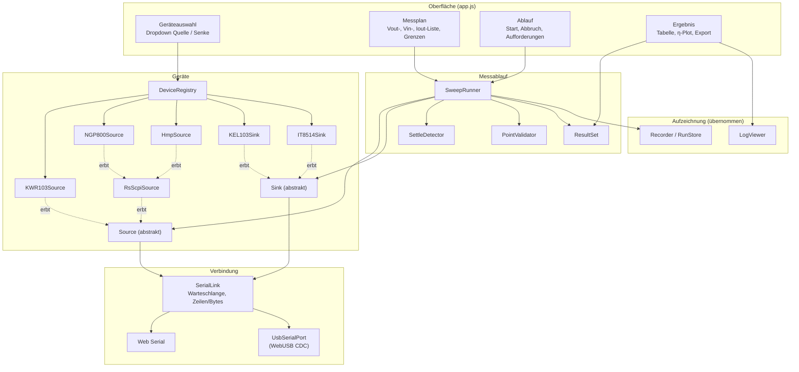
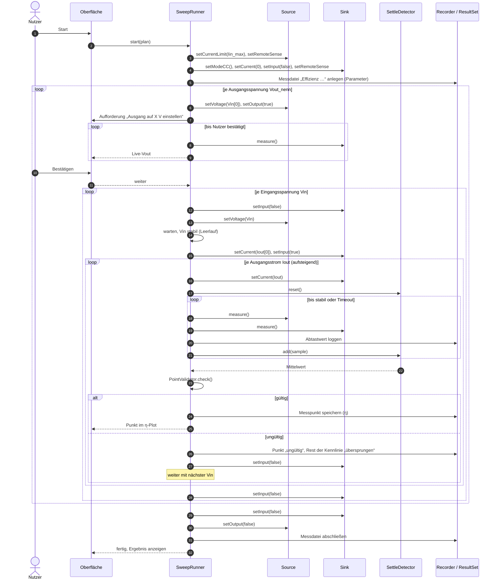
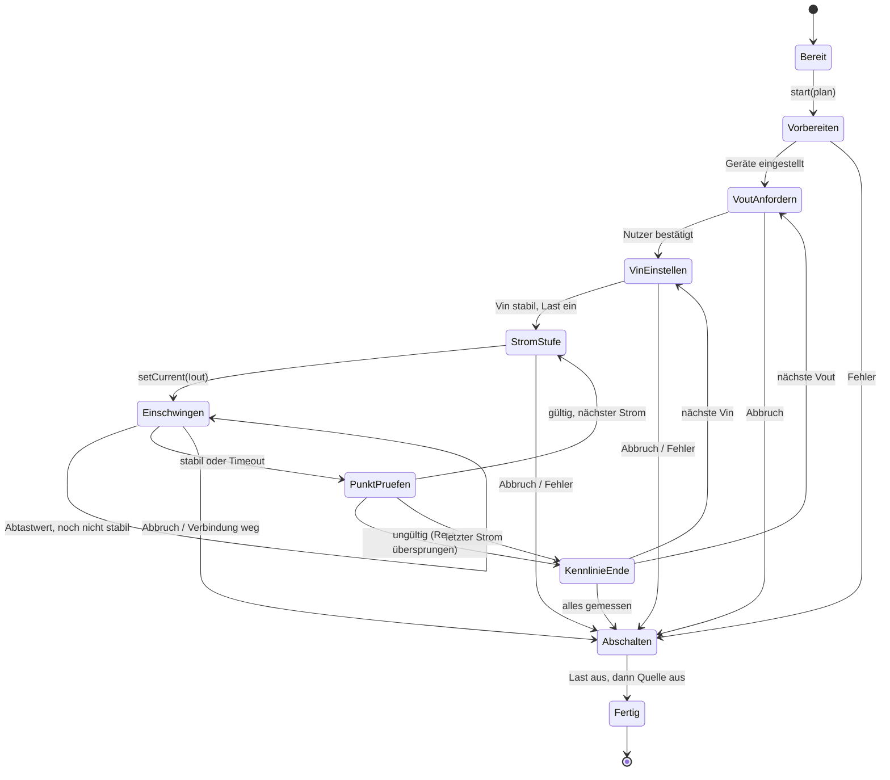

# Effizienzmessung – Softwareplanung

Browser-Anwendung zur Wirkungsgradmessung von DC/DC-Wandlern mit einer steuerbaren **Quelle** (Netzteil)
am Eingang und einer **Senke** (elektronische Last) am Ausgang. Schwesterprojekt zu *KEL103-Web* und
*KWR103-Web*, gleiche Technik: reines HTML/CSS/JavaScript, kein Build, Web Serial (Desktop) bzw.
WebUSB-CDC (Android), Messdateien in IndexedDB, CSV/ZIP-Export.

## 1. Anforderungen (aus der Aufgabenstellung und den Rückfragen)

| # | Anforderung |
|---|---|
| A1 | Quelle und Senke je über ein **Dropdown** wählbar, Verbindung immer seriell (Web Serial bzw. USB-CDC) |
| A2 | Quellen: **KORAD KWR103**, **R&S NGP800** (NGP802/822/804/814/824) und **R&S HMP2020/2030/4030/4040**, mit Kanalwahl |
| A3 | Senken: **KORAD KEL103**, **ITECH IT8514C+** |
| A4 | Weitere Geräte mit **einer neuen Datei + einem Registry-Eintrag** ergänzbar |
| A5 | **Remote Sense** an Quelle und Senke einstellbar |
| A6 | Messung über mehrere **Eingangsspannungen** × **Ausgangsströme**, optional mehrere **Ausgangsspannungen**; der Nutzer wird aufgefordert, die Ausgangsspannung am Wandler umzustellen |
| A7 | Reihenfolge **Vout → Vin → Iout**; Ströme aufsteigend, Last bleibt zwischen den Stromstufen an, vor jedem Vin-Wechsel Last aus |
| A8 | Jeder Punkt wird angefahren, dann **automatisch auf Einschwingen gewartet** (Mindestwartezeit, Pin/Pout-Änderung im Zeitfenster unter Schwelle, Timeout → Punkt mit Warnung) |
| A9 | Punkte als **Start/Stop/Schritt** oder **freie Liste** (für Vin und Iout) |
| A10 | Schafft der Wandler einen Punkt nicht (Vout bricht ein, Quelle in CC, Grenzwert überschritten): Punkt ungültig, **restliche Ströme dieser Kennlinie überspringen**, weiter mit nächster Vin |
| A11 | **Logging wie in den anderen Projekten**: eigene Messdatei je Messlauf, Spalte `info` mit Phase/Ereignissen, CSV (deutsch/international), ZIP, Datei-Betrachter mit Zoom und Cursor |
| A12 | Ergebnisplot **η über Iout**, eine Kurve je Vin/Vout-Kombination; Export als **PNG** und Ergebnistabelle als **CSV** |
| A13 | Web-App, **privates GitHub-Repo** ohne Pages |
| A14 | Handbücher (PDF) bleiben per `.gitignore` außerhalb des Repos |
| A15 | **Wandlertyp** Buck / Boost / Buck-Boost mit **Mindestabstand** Vin ↔ Vout; unpassende Vin-Werte werden je Vout ausgelassen (ohne Vout-Vorgabe: Prüfung gegen gemessene Leerlauf-Vout) |

## 2. Messprinzip

- **Pin** = U·I aus den Messwerten der Quelle, **Pout** = U·I aus den Messwerten der Senke,
  **η = Pout / Pin**, zusätzlich **Ploss = Pin − Pout** in der Tabelle.
- Mit Remote Sense messen beide Geräte die Spannung direkt an den Klemmen des Wandlers, Leitungsverluste
  gehen dann nicht in η ein. Ohne Sense wird das in der Messdatei vermerkt.
- Beide Geräte werden abwechselnd abgefragt (je ein U- und I-Wert); ein Abtastwert besteht aus
  dem Paar (Quelle, Senke) mit Zeitstempel.
- **Einschwingen** (Klasse `SettleDetector`): nach der Mindestwartezeit (Standard 2 s) laufen die Abtastwerte
  in ein gleitendes Fenster (Standard 3 s). Stabil, wenn sich Pin und Pout im Fenster um weniger als die
  Schwelle ändern (Standard 0,2 % bzw. mindestens 2 mW absolut, damit kleine Ströme nicht ewig warten).
  Der Messwert ist der **Mittelwert über das stabile Fenster**. Nach dem Timeout (Standard 30 s) wird der
  Mittelwert der letzten Fensterlänge übernommen und als „nicht eingeschwungen“ markiert.
- **Gültigkeit** eines Punkts (Klasse `PointValidator`):
  Vout ≥ (1 − Toleranz) · Vout_nenn (Standard 10 %), Quelle nicht in Strombegrenzung,
  Iin ≤ Iin_max, Pout ≤ P_max der Senke, Senke meldet keinen Schutz (OCP/OPP/OVP).
- Messgenauigkeit: Die Strommessung des KWR103 hat ±(0,1 % + 3 mA). Die Oberfläche warnt, wenn der
  Eingangsstrom eines Punkts so klein ist, dass der Fehler 2 % übersteigt (η dann nur als Richtwert).

## 2a. Geräte (aus den Handbüchern)

| Gerät | Rolle | Grenzen | Schnittstelle | Sense | CC/Schutz erkennen |
|---|---|---|---|---|---|
| **KORAD KWR103** | Quelle | 60 V / 15 A / 300 W | USB-CDC (0416:5011), 115200 | `COMP:1/0` | `STATUS?` (rohes Byte, Bit 0 = CV) |
| **R&S NGP802 / 804** | Quelle | 32 V / 20 A je Kanal, 400 / 800 W | USB **CDC** (am Gerät „USB Class = CDC“, Neustart) oder RS-232 | `VOLT:SENS AUTO` / `EXT` je Kanal | `STAT:QUES:INST:ISUM<n>:COND?` Bit 0 CC, Bit 1 CV |
| **R&S NGP822 / 824** | Quelle | 64 V / 10 A je Kanal, 400 / 800 W | wie oben | wie oben | wie oben |
| **R&S NGP814** | Quelle | Kanal 1/2: 32 V / 20 A, Kanal 3/4: 64 V / 10 A, 800 W | wie oben | wie oben | wie oben |
| **R&S HMP2020** | Quelle | 2 Kanäle: 32 V / 10 A und 32 V / 5 A, 188 W gesamt | HO720: RS-232 oder USB-VCP (FTDI) | keine SCPI-Umschaltung (Sense-Klemmen am Gerät) | `STAT:QUES:INST:ISUM<n>:COND?` 1 = CC, 2 = CV; `FUSE:TRIP?`, `VOLT:PROT:TRIP?` |
| **R&S HMP2030** | Quelle | 3 × 32 V / 5 A, 188 W | wie oben | wie oben | wie oben |
| **R&S HMP4030** | Quelle | 3 × 32 V / 10 A, 384 W | wie oben | wie oben | wie oben |
| **R&S HMP4040** | Quelle | 4 × 32 V / 10 A, 384 W | wie oben | wie oben | wie oben |
| **KORAD KEL103** | Senke | 120 V / 30 A / 300 W | USB-CDC (0416:5011), 115200 | `:SYST:COMP ON/OFF` | `:STAT?`, Messwerte |
| **ITECH IT8514C+** | Senke | 120 V / 240 A / 1500 W (Datenblatt) | RS-232 (DB9) oder USB = **Prolific PL2303** (Treiber IT-E122), 4800–38400 Baud, Standard 9600 | `SYST:SENS ON/OFF` | `STAT:QUES:COND?` Bit 0 VF, 1 OC, 3 OP, 4 OT, **8 Sense nicht angeschlossen**, 11 ungeregelt, 13 OV |

**Gemeinsame SCPI-Befehle der R&S-Netzteile** (NGP800 und HMP sind fast gleich, daher eine gemeinsame
Basisklasse `RsScpiSource`):
`INST:NSEL n` · `VOLT x` · `CURR x` · `OUTP:SEL ON` + `OUTP:GEN ON` · `MEAS:VOLT?` · `MEAS:CURR?` ·
`VOLT:PROT x` · `SYST:REM` / `SYST:LOC` · `SYST:ERR?`. Unterschiede: Das NGP800 nimmt Kanallisten
(`(@1)`) und hat den Sense-Befehl, das HMP arbeitet nur mit dem vorher gewählten Kanal.

**ITECH IT8514C+:** `SYST:REM` (Pflicht vor Befehlen über RS-232/USB), `FUNC CURR`, `CURR x`,
`CURR:RANG x` (kleinster passender Bereich für bessere Auflösung, nach dem Maximalstrom des Plans),
`INP ON/OFF`, `MEAS:VOLT?`, `MEAS:CURR?`, `MEAS:POW?`, `SYST:SENS ON/OFF`, `SYST:LOC` am Ende.

**Folgen für die Planung:**
- **Kanalwahl** für NGP800 und HMP im Verbindungsblock der Quelle; die Grenzen hängen vom Kanal ab
  (HMP2020 Kanal 2: 5 A, NGP814 Kanal 3/4: 64 V / 10 A).
- **Befehlspause je Gerät** (`DeviceInfo.gapMs`): HMP über RS-232 ohne Handshake laut Handbuch
  50–100 ms, Standard 100 ms; KORAD 50 ms.
- **Android/WebUSB**: Nur CDC-Geräte funktionieren mit dem vorhandenen `usbserial.js` (KORAD, NGP800 mit
  USB-Klasse CDC). Die IT8514C+ (Prolific PL2303) und das HMP (HO720/HO730, FTDI) brauchen einen eigenen
  USB-Protokolltreiber – **am PC mit Web Serial gehen beide sofort**. FTDI-/PL2303-Unterstützung für
  Android ist als spätere Erweiterung vorgesehen (`UsbSerialPort` bekommt dann je Chip eine Strategie).
- **Remote Sense**: KWR103, NGP800, KEL103, IT8514C+ per Befehl; beim HMP nur Hinweis
  „über die Sense-Klemmen am Gerät“ (`DeviceInfo.senseControl = false`). Die IT8514C+ meldet fehlende
  Sense-Leitungen (Bit 8) – das wird vor dem Start geprüft.
- **Gerät prüfen**: Nach dem Verbinden wird `*IDN?` mit dem gewählten Modell verglichen
  (z. B. „HMP4040“, „NGP804“, „IT8514C+“); bei Abweichung Warnung, Grenzen dann aus der Auswahl.

## 3. Architektur



### Schichten

1. **Verbindung** – `SerialLink` kapselt Port öffnen/schließen, Befehlswarteschlange mit Pause,
   Zeilen- und Byte-Auswertung (KWR103-`STATUS?` liefert ein rohes Byte). Quelle des Ports ist
   Web Serial oder `UsbSerialPort` (aus KEL103-Web übernommen).
2. **Geräte** – je Gerät eine Klasse mit einheitlicher Schnittstelle `Source` bzw. `Sink`.
   Gerätespezifisches (Befehle, Eigenheiten, Grenzen) bleibt in dieser Datei.
   Die `DeviceRegistry` liefert die Einträge für die Dropdowns.
3. **Messablauf** – `SweepRunner` (Zustandsautomat) fährt den `SweepPlan` ab, nutzt
   `SettleDetector` und `PointValidator`, schreibt in `ResultSet` und `Recorder`.
4. **Oberfläche** – verbindet alles, zeigt Live-Werte, Aufforderungen und Ergebnisse.

## 4. Klassendiagramm

```mermaid
classDiagram
  direction TB

  class SerialLink {
    -port
    -reader
    -writer
    -queue
    +gap: number
    +timeout: number
    +onLog(dir, text)
    +onDisconnect()
    +open(transport, baudRate) Promise
    +close() Promise
    +write(cmd) Promise
    +query(cmd, opts) Promise~string~
    +queryNumber(cmd) Promise~number~
    +connected: boolean
  }

  class UsbSerialPort {
    +device
    +readable
    +writable
    +request()$ Promise~UsbSerialPort~
    +open(options) Promise
    +close() Promise
  }

  class Instrument {
    <<abstract>>
    +link: SerialLink
    +info: DeviceInfo
    +options: object
    +connect(transport, baudRate) Promise
    +disconnect() Promise
    +identify() Promise~string~
    +init() Promise
    +setRemoteSense(on) Promise
    +getRemoteSense() Promise~boolean~
    +safeOff() Promise
  }

  class Source {
    <<abstract>>
    +setVoltage(v) Promise
    +setCurrentLimit(i) Promise
    +setOutput(on) Promise
    +measure() Promise~Reading~
    +status() Promise~SourceStatus~
  }

  class Sink {
    <<abstract>>
    +setModeCC() Promise
    +setCurrent(i) Promise
    +setInput(on) Promise
    +measure() Promise~Reading~
    +status() Promise~SinkStatus~
  }

  class KWR103Source {
    STATUS? als Byte
    VSET, ISET, OUT, COMP
  }
  class RsScpiSource {
    <<abstract>>
    +channel: number
    #select() Promise
    #isCC() Promise~boolean~
    SCPI INST:NSEL, VOLT, CURR, OUTP, MEAS
  }
  class NGP800Source {
    VOLT:SENS AUTO/EXT
    Kanalliste (@n)
  }
  class HmpSource {
    kein Sense-Befehl
    FUSE:TRIP?, VOLT:PROT:TRIP?
  }
  class KEL103Sink {
    :FUNC CC, :CURR, :INP
    :SYST:COMP
  }
  class IT8514Sink {
    SYST:REM, FUNC CURR, CURR, CURR:RANG, INP
    SYST:SENS, STAT:QUES:COND?
  }

  class DeviceInfo {
    +id: string
    +name: string
    +kind: source oder sink
    +vMax: number
    +iMax: number
    +pMax: number
    +baudRates: number[]
    +defaultBaud: number
    +idnMatch: RegExp
    +channels: ChannelLimits[]
    +senseControl: boolean
    +gapMs: number
    +usbCdc: boolean
  }

  class DeviceRegistry {
    -entries: Map
    +register(info, factory)
    +list(kind) DeviceInfo[]
    +create(id, options) Instrument
  }

  class Reading {
    +t: number
    +v: number
    +i: number
    +p: number
  }

  class SweepPlan {
    +vouts: VoutStep[]
    +vins: number[]
    +iouts: number[]
    +iinMax: number
    +voutTolerance: number
    +settle: SettleConfig
    +fromForm(form)$ SweepPlan
    +pointCount() number
    +estimateDuration() number
  }

  class ValueList {
    <<utility>>
    +range(start, stop, step)$ number[]
    +parse(text)$ number[]
  }

  class SettleConfig {
    +minWaitMs: number
    +windowMs: number
    +relTol: number
    +absTolW: number
    +timeoutMs: number
  }

  class SettleDetector {
    -samples: Sample[]
    +config: SettleConfig
    +reset(t)
    +add(sample) SettleState
    +result() PointAverage
  }

  class PointValidator {
    +check(sample, plan, devStatus) Violation
  }

  class MeasurementPoint {
    +voutNom: number
    +vin: number
    +ioutSet: number
    +vinMeas: number
    +iin: number
    +pin: number
    +vout: number
    +iout: number
    +pout: number
    +eta: number
    +ploss: number
    +settleMs: number
    +flag: ok, timeout, invalid, skipped
    +note: string
  }

  class Curve {
    +voutNom: number
    +vin: number
    +points: MeasurementPoint[]
    +label() string
  }

  class ResultSet {
    +meta: object
    +curves: Curve[]
    +add(point)
    +curve(voutNom, vin) Curve
    +toCsv(fmt) string
  }

  class SweepRunner {
    +state: RunnerState
    +plan: SweepPlan
    +source: Source
    +sink: Sink
    +results: ResultSet
    +onPrompt(request) Promise
    +onProgress(info)
    +onSample(sample)
    +start(plan) Promise
    +abort(reason) Promise
    -runVout(step)
    -runCurve(voutNom, vin)
    -settlePoint() PointAverage
    -sample() Sample
    -shutdown()
  }

  class Recorder {
    +start(type, name, opts)
    +add(t, v, i, p, extra)
    +event(text)
    +setPhase(text)
    +end(reason)
  }
  class RunStore
  class LogViewer
  class TimePlot
  class EfficiencyPlot {
    +setResults(results)
    +xScale: linear oder log
    +draw()
    +toPng() Blob
  }

  Instrument <|-- Source
  Instrument <|-- Sink
  Source <|-- KWR103Source
  Source <|-- RsScpiSource
  RsScpiSource <|-- NGP800Source
  RsScpiSource <|-- HmpSource
  Sink <|-- KEL103Sink
  Sink <|-- IT8514Sink
  Instrument --> SerialLink : nutzt
  SerialLink ..> UsbSerialPort : Android
  Instrument --> DeviceInfo
  DeviceRegistry o-- DeviceInfo
  DeviceRegistry ..> Instrument : erzeugt
  Source ..> Reading
  Sink ..> Reading
  SweepRunner --> SweepPlan
  SweepRunner --> Source
  SweepRunner --> Sink
  SweepRunner --> SettleDetector
  SweepRunner --> PointValidator
  SweepRunner --> ResultSet
  SweepRunner --> Recorder
  SweepPlan --> SettleConfig
  SweepPlan ..> ValueList
  SettleDetector --> SettleConfig
  ResultSet *-- Curve
  Curve *-- MeasurementPoint
  Recorder --> RunStore
  LogViewer ..> RunStore
  EfficiencyPlot ..> ResultSet
```



**Erweiterbarkeit (A4):** Ein neues Gerät = neue Datei `devices/<name>.js` mit einer Klasse, die
`Source` oder `Sink` erweitert, plus eine Zeile in `devices/index.js`:

```js
// eine Zeile je Modell; mehrere Modelle teilen sich eine Klasse
const ch = (n, vMax, iMax) => Array.from({ length: n }, () => ({ vMax, iMax }));
registry.register({ id: 'hmp4040', name: 'R&S HMP4040', kind: 'source', idnMatch: /HMP4040/,
  channels: ch(4, 32, 10), pMax: 384, baudRates: [9600, 19200, 38400, 57600, 115200],
  defaultBaud: 9600, gapMs: 100, senseControl: false, usbCdc: false }, (o) => new HmpSource(o));
registry.register({ id: 'hmp2020', name: 'R&S HMP2020', kind: 'source', idnMatch: /HMP2020/,
  channels: [{ vMax: 32, iMax: 10 }, { vMax: 32, iMax: 5 }], pMax: 188, /* … */ }, (o) => new HmpSource(o));
registry.register({ id: 'it8514c', name: 'ITECH IT8514C+', kind: 'sink', idnMatch: /IT8514C/,
  channels: ch(1, 120, 240), pMax: 1500, baudRates: [4800, 9600, 19200, 38400],
  defaultBaud: 9600, gapMs: 50, senseControl: true, usbCdc: false }, (o) => new IT8514Sink(o));
```

Die Dropdowns, Grenzen der Eingabefelder, Kanalauswahl und der Sense-Schalter richten sich nach `DeviceInfo`.

## 5. Ablauf einer Messung (Sequenzdiagramm)



## 6. Zustandsautomat `SweepRunner`



**Sicherheitsreihenfolge beim Abschalten:** immer zuerst die **Senke aus**, dann die **Quelle aus**
(sonst kann der Wandler bei angeschlossener Last ohne Eingang undefiniert arbeiten). Gilt auch bei
Verbindungsabbruch eines Geräts, Fehlern und beim Schließen der Seite (`beforeunload`, best effort).

## 7. Oberfläche

1. **Kopf:** zwei Verbindungsblöcke nebeneinander – *Quelle* und *Senke*, je mit Dropdown (Gerät aus der
   Registry), Schnittstelle (Seriell/WebUSB), Baudrate, ggf. Kanal (NGP800), Verbinden-Button, Status, IDN.
2. **Live-Anzeige:** Vin, Iin, Pin | Vout, Iout, Pout | η (aktuell), Verlauf als `TimePlot` (Pin, Pout, η).
3. **Messplan:**
   - Ausgangsspannungen (Liste, nur Beschriftung/Prüfwert – der Nutzer stellt sie am Wandler ein; leer = eine Messung ohne Aufforderung)
   - Eingangsspannungen: Start/Stop/Schritt oder Liste
   - Ausgangsströme: Start/Stop/Schritt oder Liste
   - Grenzen: Iin max (Strombegrenzung der Quelle), Vout-Toleranz
   - Einschwingen: Mindestwartezeit, Fenster, Schwelle relativ/absolut, Timeout
   - Remote Sense Quelle / Senke
   - Anzeige: Anzahl Punkte, geschätzte Dauer
4. **Ablauf:** Start / Abbruch, Fortschritt (Punkt n von m, aktuelle Vout/Vin/Iout, Einschwingstatus),
   Dialog für die Vout-Aufforderung mit Live-Vout und „Übernehmen“.
5. **Ergebnis:** η-Plot (x: Iout, linear oder logarithmisch; y: η in %; eine Kurve je Vout/Vin mit Legende,
   Fadenkreuz), Ergebnistabelle, Buttons **PNG** und **CSV**.
6. **Messdateien** und **Betrachter** wie in KEL103-/KWR103-Web, **Konsole** für beide Geräte.

## 8. Dateien

```
Effizienzmessung-Web/
  index.html, style.css
  app.js                 UI-Controller (Geräteblöcke, Live-Anzeige, Handsteuerung, Plan, Ablauf, Ergebnis, Dateien)
  link/serial-link.js    SerialLink (Warteschlange, Zeilen/Bytes; Web Serial oder WebUSB)
  link/usbserial.js      WebUSB-CDC (aus KEL103-Web)
  devices/base.js        Instrument, Source, Sink
  devices/index.js       DeviceRegistry + Registrierung aller Modelle
  devices/korad.js       KWR103Source, KEL103Sink
  devices/rs-scpi.js     RsScpiSource, NGP800Source, HmpSource
  devices/itech.js       ITechSink (IT8514C+)
  devices/sim.js         SimSource, SimSink + Wandler-Modell (Test ohne Hardware)
  sweep/plan.js          SweepPlan, ValueList, DEFAULT_SETTLE
  sweep/settle.js        SettleDetector, validatePoint
  sweep/runner.js        SweepRunner
  sweep/results.js       ResultSet (+ Ergebnis-CSV)
  effplot.js             EfficiencyPlot (+ PNG)
  plot.js, viewer.js, runs.js   aus KEL103-Web (DB „effizienz“)
```

## 9. Messdateien

- **Eine Datei je Messlauf** (`effizienz_<Datum>_<Wandlername>.csv`): alle Abtastwerte mit
  `zeit; zeit_s; vin_V; iin_A; pin_W; vout_V; iout_A; pout_W; eta_pct; vout_nenn_V; vin_soll_V; iout_soll_A; info`.
  `info` enthält Phase und Ereignisse („Einschwingen 1,0 A“, „Punkt übernommen η=91,2 %“,
  „ungültig: Vout 4,1 V < 4,5 V“, „Nutzer: Vout 5 V bestätigt“).
- **Ergebnisdatei** (Download „CSV“): ein Messpunkt je Zeile mit η, Ploss, Einschwingzeit, Flag.
- Kopf wie gewohnt: Wandler/Bezeichnung (Freitext), Quelle/Senke mit IDN, Sense-Zustand, Plan, Grenzen.
- `runs.js` erhält dafür eine zweite Spannungs-/Stromgruppe; der Betrachter zeigt alle Zahlenspalten
  (wie bisher über `extraCols`).

## 10. Umsetzungsschritte

1. Gerüst, `SerialLink` aus den bestehenden Treibern herauslösen, Registry, KWR103 + KEL103 portieren,
   Verbindungsblöcke mit Dropdown – am vorhandenen Aufbau testbar.
2. `SettleDetector` + `PointValidator` mit Unit-Tests (simulierte Messreihen).
3. `SweepRunner` mit Simulator-Geräten (Quelle + Senke + Wandlermodell η(I)) im Browser testen,
   dann an der Hardware (KWR103 → Wandler → KEL103; ohne Wandler: direkt verbunden, η ≈ 100 %).
4. Ergebnisplot, PNG/CSV-Export, Messdateien, Betrachter.
5. IT8514C+, HMP-Serie und NGP800 nach Handbuch umsetzen; Hardwaretest durch dich
   (diese Geräte sind nicht an meinem Rechner) – die Konsole hilft beim Prüfen einzelner Befehle.
6. Später: FTDI- und PL2303-Unterstützung in `usbserial.js` für HMP und IT8514C+ unter Android.

## 11. Offene Punkte / zu prüfen

- **Handbücher** liegen vor (IT8500+ Programming Guide, HMP SCPI Programmers Manual, NGP800 User Manual)
  und sind in Abschnitt 2a ausgewertet. Nicht im Handbuch: Grenzwerte der IT8514C+ (aus dem Datenblatt,
  am Gerät mit `CURR? MAX` / `VOLT? MAX` prüfen) und das genaue `*IDN?`-Format der Geräte.
- **NGP800**: USB-Klasse am Gerät auf **CDC** stellen (Menü Netzwerkverbindungen → USB Class), danach
  Neustart. Mit TMC ist kein serieller Zugriff möglich.
- **HMP**: Schnittstellenkarte HO720/HO730 im Menü auf USB (VCP) oder RS-232 stellen; unter Windows den
  VCP-Teil des R&S-USB-Treibers installieren.
- **IT8514C+ über USB**: Treiber IT-E122 (Prolific) installieren; Baudrate am Gerät (Shift + 8) und auf
  der Website gleich einstellen. DB9 und USB nicht gleichzeitig anschließen.
- Beide Geräte gleichzeitig: eine Seite darf zwei serielle Ports öffnen (bereits geklärt) – unter Android
  zwei USB-Geräte über einen OTG-Hub.
- Vout-Aufforderung: Soll die Senke dabei eine kleine Grundlast ziehen (manche Wandler regeln im Leerlauf
  nicht sauber)? Vorschlag: einstellbar, Standard 0 A.
